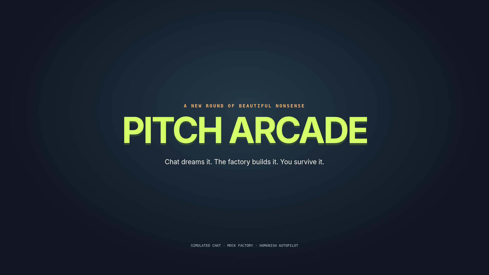
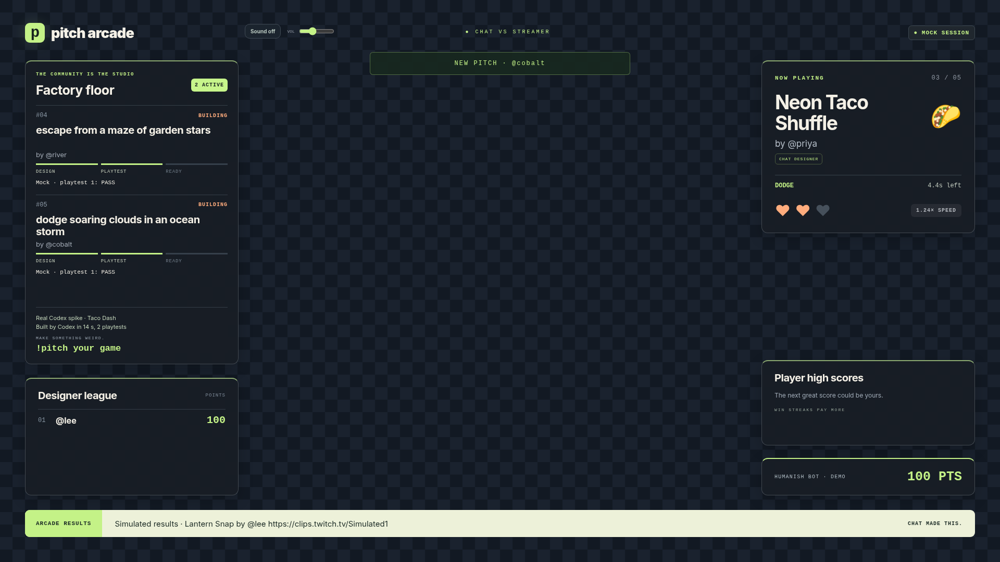
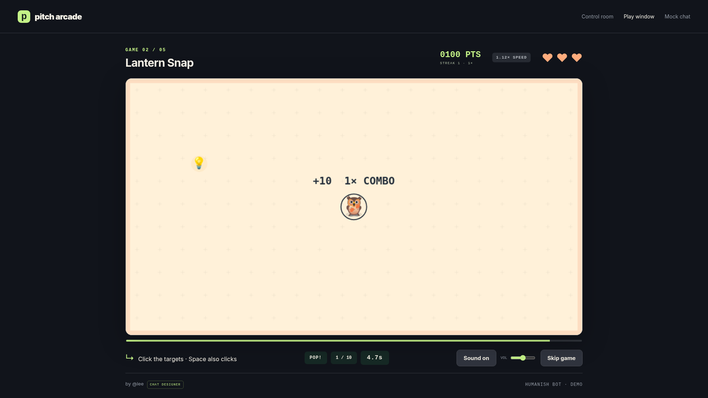
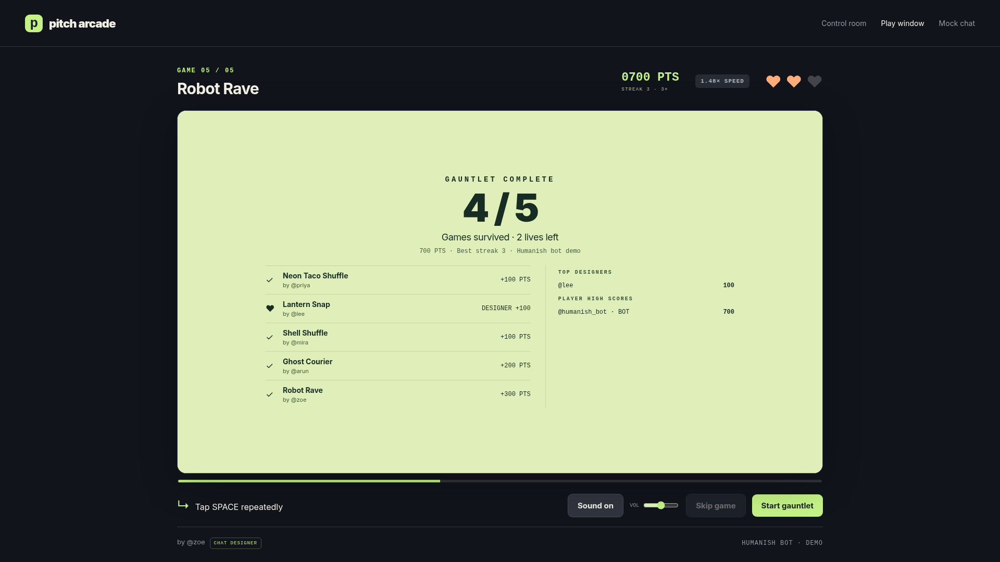
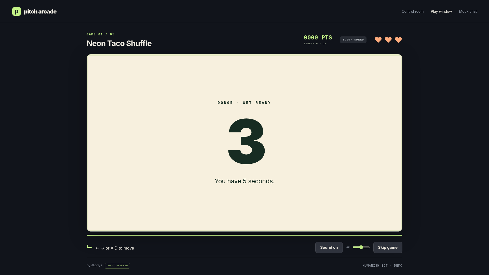
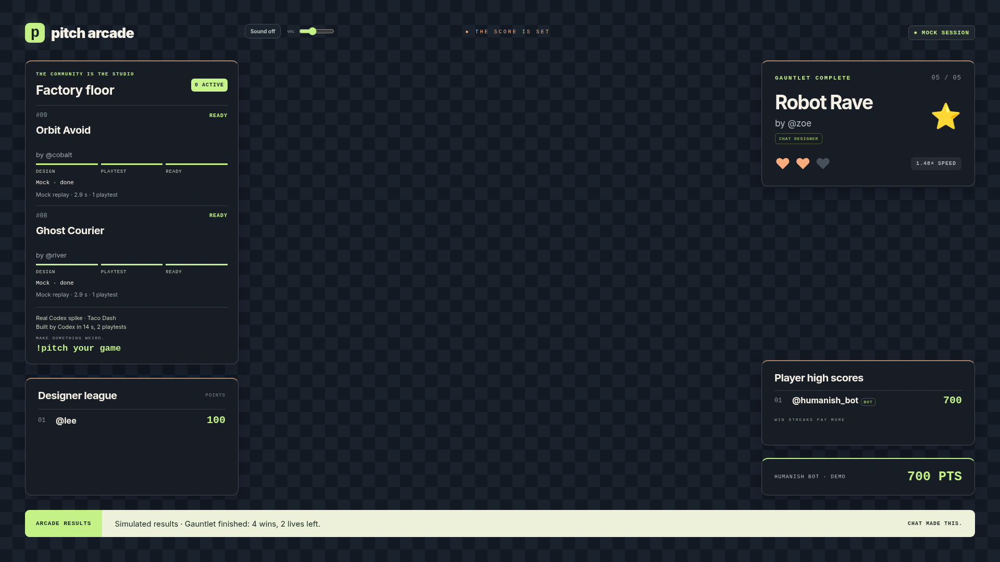
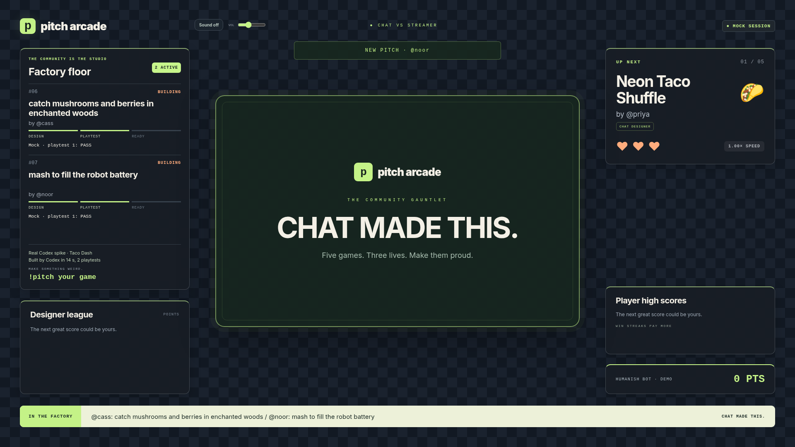

# Pitch Arcade

**Chat makes the games. You try to survive.**

One viewer pitches falling tacos. Another wants an octopus picnic. A constrained Codex factory turns those ideas into five second microgames, tests them and sends them for approval. Five games. Three lives. Every designer gets the credit.



## Watch the whole show

```sh
git clone https://github.com/Anandb71/pitch-arcade.git
cd pitch-arcade
npm install
npm run demo:video
```

Use Node 22.11 or newer and npm 10.9 or newer. No credentials or Codex installation are needed for the demo. After installation, it runs without network access.

Open **[play](http://127.0.0.1:3000/play/?sound=1)** and **[overlay](http://127.0.0.1:3000/overlay/?backdrop=1&sound=0)**. Click play once to unlock sound. The terminal prints every URL and an OBS checklist.

The repeatable 110 second loop includes an opening hype card, funny chat pitches, visible moderation, simulated factory work, approvals, a humanish bot gauntlet and final credits. Seed 8 wins four games and loses one. Add `--hold` to keep the leaderboard up:

```sh
npm run demo:video -- --hold
npm run demo:video -- --seed=8
npm run record
```

The recorder saves a silent 1920 by 1080 video to `shots/demo.webm`. It uses local Chromium through Playwright. Use OBS for synthesized audio. See the [recording guide](docs/video.md) for the schedule and browser requirements.

## The stream moment

| The factory is working | One hit can save the run |
| --- | --- |
|  |  |

| Chat gets the credit | The streamer gets a control room |
| --- | --- |
|  |  |

These are screenshots of running local sessions. Factory workers shown here are mock replays. The overlay labels a real historical Codex receipt separately from its simulated clip link. [Capture details](shots/manifest.json) record each scene.

## What makes it an arcade

* **A proper entrance.** Branded intros, a 3 2 1 GO countdown and eased broadcast transitions.
* **Small games with feel.** Eight palettes, five patterns, emoji sprites, particles, bounded shake, brief hit stop and cosmetic combo pops. Reduced motion is respected. No full screen flashes.
* **Original sound.** Synthesized hits, countdown beeps, score ticks, pitch whooshes, win fanfares and lose buzzes. Mute and volume controls on play and overlay.
* **Credit that sticks.** Every game names its viewer designer. SQLite persists designer totals and player high scores. Bot runs are labeled.
* **A factory you can watch.** Sanitized build steps and honest receipts show what happened. Approval and preview stay in the dashboard.
* **Quality after correctness.** Forty seeds with three bots, then nine extra quality gates for skill separation, meaningful input, engagement and novelty. A reskin does not count as a new mechanic.

The library has 30 seed classics and three games from real Codex jobs. Ten of those seeds meet the newer quality gates. A bank of 38 measured mock variants keeps demos varied. See [quality rules and v1 limits](docs/quality.md). Physical stacking, precise rhythm scoring and hidden memory rules are outside this format.

## Other ways to play

| Command | Experience |
| --- | --- |
| `npm run demo` | Pitch in mock chat, preview, approve and play yourself |
| `npm run demo:auto` | Five scripted pitches and a humanish run, then hold results |
| `npm run demo:twitch-sim` | Real EventSub and Helix clients talking to local fake servers |
| `npm run demo:video` | The complete recording loop with moderation and approvals |

| Page | URL |
| --- | --- |
| Play | http://127.0.0.1:3000/play/ |
| Dashboard | http://127.0.0.1:3000/dashboard/ |
| Mock chat | http://127.0.0.1:3000/chat/ |
| OBS overlay | http://127.0.0.1:3000/overlay/ |

Mock generation is explicitly simulated. No Twitch clip is published by these commands. Press Ctrl+C to stop. A custom PORT changes all page URLs.

## How Codex was used

**Build:** one main Codex thread wrote the original engine, game format, bot harness, Twitch adapters, browser clients, tests and recording tools. The session is `01a18380-92df-7fb1-84cd-1b45659bee41`. The current suite has **219 passing tests**.

**Runtime:** live jobs use the installed Codex CLI with **gpt-6.1-sol** by default. Each isolated job receives untrusted pitch data and a short digest of recent mechanics and themes. It writes JSON, uses the trusted playtest tool and gets at most one repair within the same total budget. The server independently checks everything before approval. Mock mode makes no model call.

Three actual runtime jobs were measured earlier with gpt-6-luna. All passed the validation gates in place at that time. Median build time was **15.900 seconds**, with **two playtests per game**. Reported usage totaled 461039 input tokens and 3096 output tokens across tool turns. The injection pitch became a harmless catching game. These are historical measurements, not a benchmark of the current Sol prompt or newer quality gates. See [Build and Runtime](docs/codex.md).

## Real Twitch setup

1. Create a separate Twitch bot account. Enable 2FA on the account that will register the developer app.
2. In the broadcaster's chat, run `/mod your_bot_login`.
3. Register an app at the Twitch developer console. Choose a confidential client. For the redirect flow, add `http://localhost:8787/callback` as its OAuth redirect URL. The device flow does not use a localhost callback.
4. Copy `.env.example` to `.env`. Set `TWITCH_CLIENT_ID`, `TWITCH_CLIENT_SECRET`, `TWITCH_BROADCASTER_LOGIN` and `TWITCH_BOT_LOGIN`. Leave mock flags empty for live operation.
5. On a headless box, run `npm run auth -- --device --role=broadcaster`, then `npm run auth -- --device --role=bot`. Open the verification page on any browser, enter the displayed user code and sign in as the expected account. Keep the terminal running while it waits. On a machine with a local browser, `npm run auth` keeps the redirect flow available. Each login must match its configured account.
6. Run `npm run auth:check` to validate scopes. Run `npm run doctor` to check the environment.
7. Sign in to the installed Codex CLI with ChatGPT. The runtime profile is verified for codex-cli 0.165.0. Run `npm run factory:check` before using real generation.
8. Run `npm run start`. Open the dashboard and play page. Start a stream with clips enabled before testing clip publication.

The bot requests `user:read:chat`, `user:write:chat` and `user:bot`. The broadcaster requests `channel:bot`, `clips:edit` and `user:read:chat`. Device authorization prints only the verification page, user code, expiry and safe account guidance. Client credentials and the device code stay private. Both grants support refresh. Tokens live outside the repo at `~/.config/pitch-arcade/tokens.json` with mode 0600. Never paste tokens into chat. `OPENAI_API_KEY` is optional and enables moderation only. Codex generation uses the CLI sign in.

See [setup](docs/setup.md) for the checklist and [Twitch details](docs/twitch.md) for refresh, scopes and reconnect behavior.

## OBS and controls

Use a window capture for `http://127.0.0.1:3000/play/`. The logical game is 960 by 540. Crop the window capture to the visible arena, preserve its 16:9 ratio, then size the cropped source to 960 by 540 in OBS. Place that source at x 480 and y 270 on the OBS canvas. Browser chrome and viewport size affect the crop.

Add an OBS browser source for `http://127.0.0.1:3000/overlay/`. Set width 1920 and height 1080. Place it above the play capture. The center stays transparent. `?backdrop=1` adds a checker preview for screenshots. Keep that query off in OBS.

Arrows or WASD move. Space or mouse clicks hit targets. Repeated space or mouse taps mash. Double tap S or press Shift + S to skip. A normal S press still moves down. Sound defaults on for play and resumes on the first interaction when the browser requires it. Use ?sound=0 to mute play. The overlay defaults to muted; use ?sound=1 for OBS audio. Both pages have mute and volume controls.

Wins earn 100 points times the current win streak, capped at 5×. Losses award the designer 100 points. A loss or skip resets the streak. Designer totals and player high scores persist in SQLite. Bot scores are labeled. Final cards credit every game. Render combo pops are decorative and do not change these scores.

The dashboard has approve, reject, preview, skip, stop and pause controls. Pause stops intake and active work. Optional auto approval applies to validated mod or VIP pitches. Chat cannot control gameplay.

## Environment variables

Demo commands set their own mock flags. Live mode needs the four Twitch settings below plus saved OAuth grants. Blank optional values use defaults.

| Name | Required | Purpose |
| --- | --- | --- |
| TWITCH_CLIENT_ID | Live | Registered app ID |
| TWITCH_CLIENT_SECRET | Live | App secret, kept in .env |
| TWITCH_BROADCASTER_LOGIN | Live | Expected broadcaster login |
| TWITCH_BOT_LOGIN | Live | Expected bot login |
| TWITCH_TOKEN_PATH | Optional | Private token path outside the repo |
| MOCK_TWITCH | Optional | 1 uses mock chat |
| MOCK_CODEX | Optional | 1 uses curated factory replays |
| PORT | Optional | Local server port, default 3000 |
| ARCADE_DB_PATH | Optional | SQLite file, default data/arcade.sqlite |
| OPENAI_API_KEY | Optional | OpenAI moderation only |
| FACTORY_MODEL | Optional | CLI model, default gpt-6.1-sol |
| FACTORY_MAX_JOBS_PER_HOUR | Optional | Job budget, default 20, maximum 100 |
| PITCH_COOLDOWN_MS | Optional | Per user cooldown, default 120000 |
| PITCH_QUEUE_CAP | Optional | Queue capacity, default and maximum 20 |
| MOCK_FACTORY_STEP_MS | Optional | Replay step delay, default 350 |
| MOCK_EVENTSUB_URL | Optional | Loopback mock WebSocket for separate replay |
| MOCK_TWITCH_PORT | Optional | Separate mock server port, default 8081 |
| TWITCH_EVENTSUB_URL | Optional | EventSub override on the Twitch host or loopback fixture |
| TWITCH_STRETCH | Optional | 1 adds optional scopes during auth |
| TWITCH_PIN | Optional | 1 pins sent chat, needs extra scope and moderator role |
| TWITCH_MARKERS | Optional | 1 creates a marker at gauntlet end, needs extra scope |
| CHROME_PATH | Optional | Browser executable for screenshots |
| CODEX_BUILD_THREAD_ID | Optional | Verified main session ID for seed regeneration |
| CODEX_HOME | Optional | Standard Codex CLI configuration location |
| DEMO_AUTO | Internal | Enables scripted demo and mock screenshot controls |
| TWITCH_SIM | Internal | Selects local EventSub and Helix fixtures |
| DEMO_VIDEO | Internal | Selects the recording schedule |
| DEMO_VIDEO_HOLD | Internal | Keeps final recording credits visible |
| DEMO_VIDEO_SEED | Internal | Recording seed, default 8 |

Standard `HOME`, `PATH`, `LANG`, `LC_ALL`, `TERM` and `TZ` are inherited by the factory controller. Other parent environment values are excluded from its command environment. Do not add secrets to those standard variables.

## Architecture

```text
Twitch EventSub or mock chat
             ↓
Intake → moderation → SQLite queue
             ↓
Two isolated factory jobs → JSON only
             ↓
Schema → semantics → secret scan → independent bot harness
             ↓
Quality gates → bounded repair or dashboard approval
             ↓
Library → server gauntlet at 60 Hz
             ↓
Play canvas + OBS overlay + dashboard
             ↓
ResultsSink → paced Helix chat and clip requests
```

The pure engine lives in `packages/engine`. The harness, renderer, Twitch clients and shared protocol have their own packages. `apps/server` owns intake, storage, approval and the authoritative clock. The build syncs the isolated designer template from canonical sources.

## Safety model

Games are data. The closed schema allows known controls, motions, verbs and emoji. Chat text never becomes code, HTML, a shell command or a file path. The factory has protected instructions, disabled command network access, OS boundary probes and a total 150 second deadline. The server ignores the agent's claimed report and reruns its own validation. Human approval or an explicit trusted role rule gates viewer games.

Local controls bind to 127.0.0.1 and check Host, Origin and a custom mutation header. Keep them on a trusted machine. Heuristic moderation and secret scanning have limits. See [security](SECURITY.md) and the [six finding review](docs/review.md).

## Tests and evidence

```sh
npm test
npm run build
npm run lint:prose
npm run demo:video:check
npm run playtest -- library/01-taco-rain.json
npm run shots
```

219 tests cover deterministic outcomes, validation, quality gates, queue races, sandbox boundaries, OAuth refresh, local Twitch protocols, rankings and repeated recording cycles. [Fresh clone proof](docs/fresh-clone.md) records installation, the suite and the recording command from a clean checkout.

The screenshot script captures actual gameplay, hit feedback, factory work, opening cards, approvals and credited results at 1920 by 1080. It also checks sound, reduced motion, input, preview isolation and literal untrusted HTML rendering.

<details>
<summary>More from the arcade</summary>

| Countdown | A different kind of chaos |
| --- | --- |
|  |  |
|  |  |
|  |  |

</details>

## Honest status

Real Codex jobs, browser controls and local Twitch protocol tests have run successfully. OAuth uses a fake ID server in tests. EventSub reconnects and Helix chat and clip requests use local fixtures. **Live Twitch authorization, public chat delivery and a published clip have not been verified here.**

The factory permission profile currently accepts codex-cli 0.165 only. Other versions and hosts need a fresh policy review. The current Sol default and newer quality prompt have not received another real model spike. Clip publication needs a live channel, enabled clips and valid grants.

The remaining human steps are real account authorization, a live stream and OBS check, and recording and publishing the submission video.

MIT license, copyright Anand Biju. [Assets](ASSETS.md) · [Setup](docs/setup.md) · [Devpost draft](DEVPOST.md)
