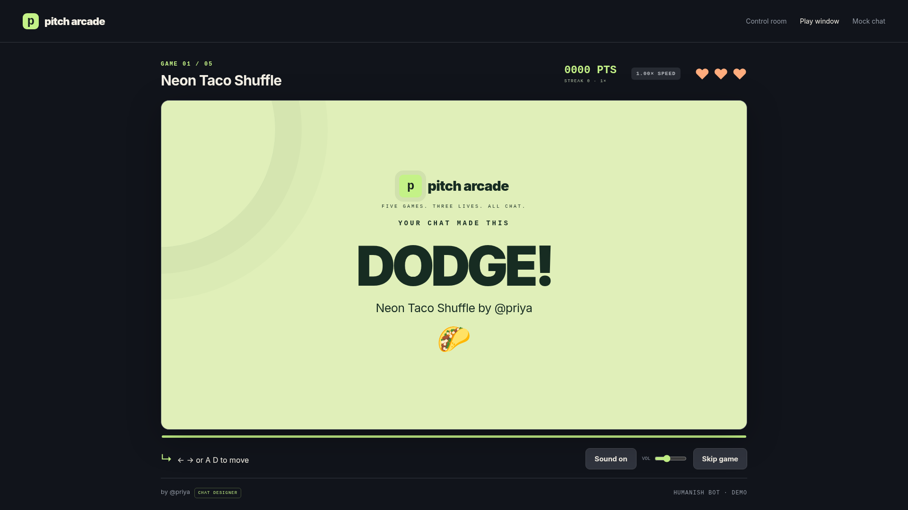
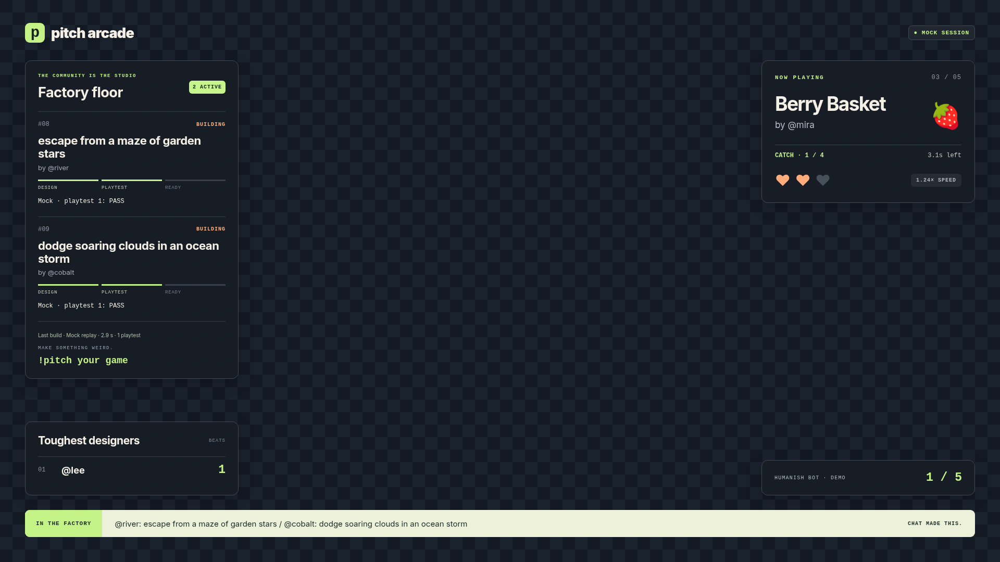
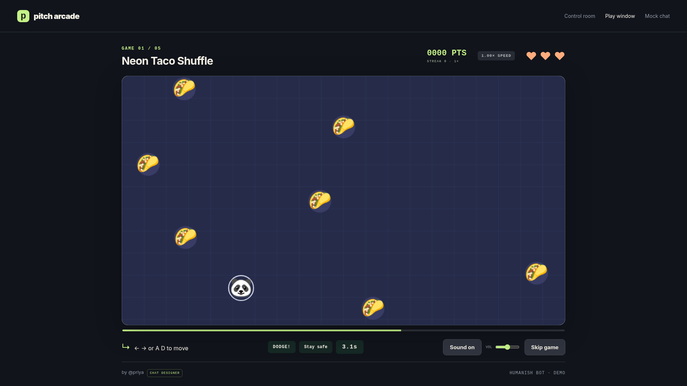
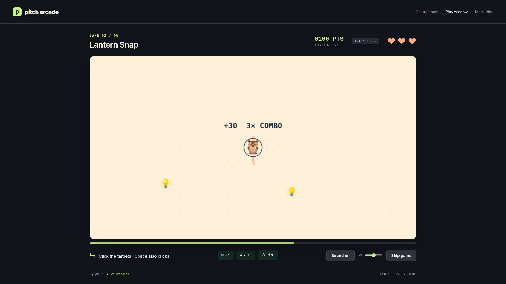
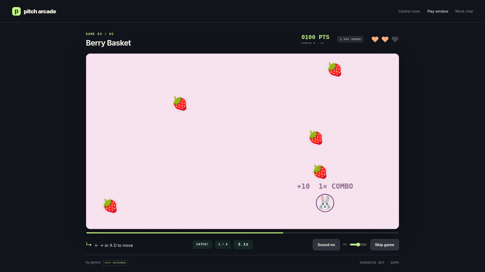
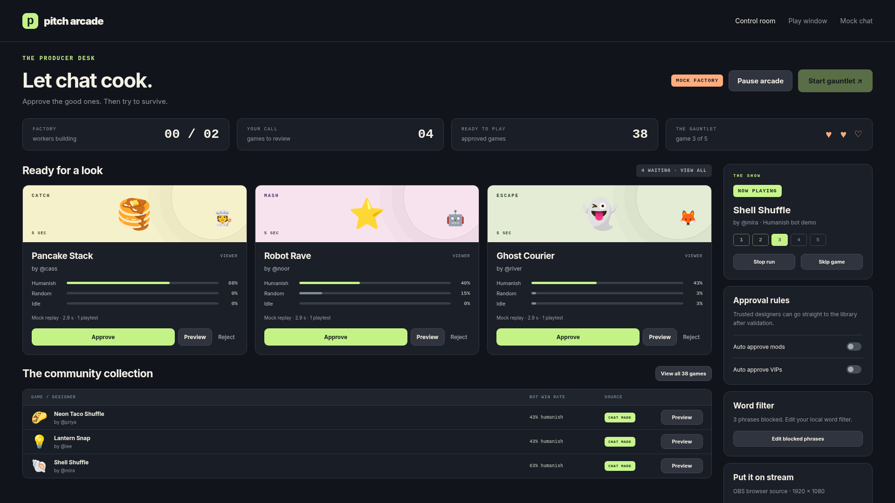
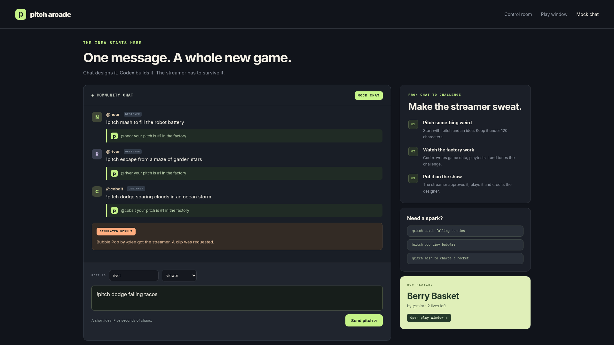
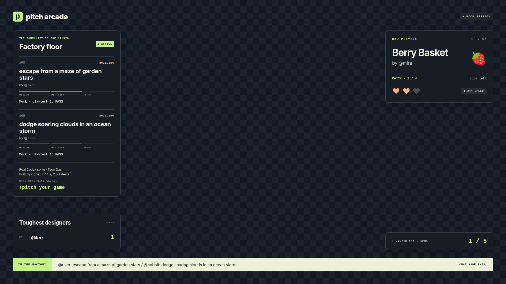

# Pitch Arcade

Your chat makes the games. You have to survive them.

## What it is

Viewers pitch five second games with `!pitch`. A constrained Codex factory writes JSON, tests it with bots and sends it for approval. The streamer plays five approved games with three lives. An OBS overlay credits the designers and shows the factory at work.

## 60 second quickstart

Use Node 22.11 or newer, npm 10.9 or newer, and git.

```sh
git clone https://github.com/Anandb71/pitch-arcade.git
cd pitch-arcade
npm install
npm run demo
```

Open these pages:

| Page | URL |
| --- | --- |
| Play | http://127.0.0.1:3000/play/ |
| Dashboard | http://127.0.0.1:3000/dashboard/ |
| Mock chat | http://127.0.0.1:3000/chat/ |
| OBS overlay | http://127.0.0.1:3000/overlay/ |

Send `!pitch dodge falling tacos` in mock chat. Approve the built game in the dashboard. Start a gauntlet. Twenty seed classics and three validated real Codex spike games fill the library.

The demo needs no credentials or Codex installation. It works offline after dependencies are installed. Factory generation is a labeled replay. No Twitch clip is published. Press Ctrl+C to stop.

## Let it run itself

```sh
npm run demo:auto
```

Five mock designers pitch games. Their games pass validation and receive scripted approvals. The humanish bot plays a full gauntlet. The final score stays on screen. Each run gets a fresh database unless `ARCADE_DB_PATH` is set.

```sh
npm run demo:twitch-sim
```

This runs the real EventSub and Helix client code against local fixture servers. Pitches travel over WebSocket. Subscriptions, chat and clip requests travel over HTTP. Mock generation feeds a humanish gauntlet. Clip links are visibly simulated fixtures. No Twitch account is needed.

## Real Twitch setup

1. Create a separate Twitch bot account. Enable 2FA on the account that will register the developer app.
2. In the broadcaster's chat, run `/mod your_bot_login`.
3. Register an app at the Twitch developer console. Choose a confidential client. Add `http://localhost:8787/callback` as its OAuth redirect URL.
4. Copy `.env.example` to `.env`. Set `TWITCH_CLIENT_ID`, `TWITCH_CLIENT_SECRET`, `TWITCH_BROADCASTER_LOGIN` and `TWITCH_BOT_LOGIN`. Leave mock flags empty for live operation.
5. Run `npm run auth`. Open the first printed URL as the broadcaster, then the next as the bot. Each login must match its configured account.
6. Run `npm run auth:check` to validate scopes. Run `npm run doctor` to check the environment.
7. Sign in to the installed Codex CLI with ChatGPT. The runtime profile is verified for codex-cli 0.165.0. Run `npm run factory:check` before using real generation.
8. Run `npm run start`. Open the dashboard and play page. Start a stream with clips enabled before testing clip publication.

The bot requests `user:read:chat`, `user:write:chat` and `user:bot`. The broadcaster requests `clips:edit`. Tokens live outside the repo at `~/.config/pitch-arcade/tokens.json` with mode 0600. Never paste tokens into chat. `OPENAI_API_KEY` is optional and enables moderation only. Codex generation uses the CLI sign in.

See [setup](docs/setup.md) for the checklist and [Twitch details](docs/twitch.md) for refresh, scopes and reconnect behavior.

## OBS and controls

Use a window capture for `http://127.0.0.1:3000/play/`. The logical game is 960 by 540. Crop the window capture to the visible arena, preserve its 16:9 ratio, then size the cropped source to 960 by 540 in OBS. Place that source at x 480 and y 270 on the OBS canvas. Browser chrome and viewport size affect the crop.

Add an OBS browser source for `http://127.0.0.1:3000/overlay/`. Set width 1920 and height 1080. Place it above the play capture. The center stays transparent. `?backdrop=1` adds a checker preview for screenshots. Keep that query off in OBS.

Arrows or WASD move. Space or mouse clicks hit targets. Repeated space or mouse taps mash. Double tap S or press Shift + S to skip. A normal S press still moves down. Sound starts only after a gesture and is off by default.

The dashboard has approve, reject, preview, skip, stop and pause controls. Pause stops intake and active work. Optional auto approval applies to validated mod or VIP pitches. Chat cannot control gameplay.

## Environment variables

Demo commands set their own mock flags. Live mode needs the four Twitch settings below plus saved OAuth grants. Blank optional values use defaults.

| Name | Required | Purpose |
| --- | --- | --- |
| TWITCH_CLIENT_ID | Live | Registered app ID |
| TWITCH_CLIENT_SECRET | Live | App secret, kept in .env |
| TWITCH_BROADCASTER_LOGIN | Live | Expected broadcaster login |
| TWITCH_BOT_LOGIN | Live | Expected bot login |
| TWITCH_TOKEN_PATH | Optional | Private token path outside the repo |
| MOCK_TWITCH | Optional | 1 uses mock chat |
| MOCK_CODEX | Optional | 1 uses curated factory replays |
| PORT | Optional | Local server port, default 3000 |
| ARCADE_DB_PATH | Optional | SQLite file, default data/arcade.sqlite |
| OPENAI_API_KEY | Optional | OpenAI moderation only |
| FACTORY_MODEL | Optional | CLI model, default gpt-6.1-sol |
| FACTORY_MAX_JOBS_PER_HOUR | Optional | Job budget, default 20, maximum 100 |
| PITCH_COOLDOWN_MS | Optional | Per user cooldown, default 120000 |
| PITCH_QUEUE_CAP | Optional | Queue capacity, default and maximum 20 |
| MOCK_FACTORY_STEP_MS | Optional | Replay step delay, default 350 |
| MOCK_EVENTSUB_URL | Optional | Loopback mock WebSocket for separate replay |
| MOCK_TWITCH_PORT | Optional | Separate mock server port, default 8081 |
| TWITCH_EVENTSUB_URL | Optional | EventSub override on the Twitch host or loopback fixture |
| TWITCH_STRETCH | Optional | 1 adds optional scopes during auth |
| TWITCH_PIN | Optional | 1 pins sent chat, needs extra scope and moderator role |
| TWITCH_MARKERS | Optional | 1 creates a marker at gauntlet end, needs extra scope |
| CHROME_PATH | Optional | Browser executable for screenshots |
| CODEX_BUILD_THREAD_ID | Optional | Verified main session ID for seed regeneration |
| CODEX_HOME | Optional | Standard Codex CLI configuration location |
| DEMO_AUTO | Internal | Enables scripted demo and mock screenshot controls |
| TWITCH_SIM | Internal | Selects local EventSub and Helix fixtures |

Standard `HOME`, `PATH`, `LANG`, `LC_ALL`, `TERM` and `TZ` are inherited by the factory controller. Other parent environment values are excluded from its command environment. Do not add secrets to those standard variables.

## Architecture

```text
Twitch EventSub or mock chat
             ↓
Intake → moderation → SQLite queue
             ↓
Factory with two isolated Codex CLI jobs
             ↓
JSON schema → semantic checks → independent bot harness
             ↓
Dashboard approval → library → server gauntlet at 60 Hz
                                  ↓
                     Play canvas + OBS overlay + dashboard
                                  ↓
                     ResultsSink → Helix chat and clips
```

`packages/engine` is pure simulation and validation. `packages/harness` runs bots. `packages/render` draws snapshots and handles local input. `packages/twitch` owns OAuth and wire protocols. `packages/shared` holds browser and server types. `apps/server` owns storage, approval and the authoritative game clock. The build syncs the isolated designer template from canonical sources.

## Safety model

Games are data. The closed schema permits known verbs, emoji and behaviors. Chat text never becomes a command, HTML or file path. Factory commands have a verified sandbox, no network, protected instructions and a 150 second deadline. The server independently checks output and reruns forty seeds with three bots. Human approval or an explicit trusted role rule gates viewer games.

Local controls bind to 127.0.0.1 and check Host, Origin and a custom mutation header. Use them on a trusted machine. The heuristic moderation fallback and secret scanner have limits. They are defense layers, not guarantees. See [security](SECURITY.md) and the [six finding review](docs/review.md).

## Tests and screenshots

```sh
npm test
npm run build
npm run lint:prose
npm run playtest -- library/01-taco-rain.json
npm run shots
```

The suite has 168 passing tests. It covers deterministic outcomes, schema and semantic checks, bot acceptance, queue races, sandbox boundaries, OAuth refresh, local Twitch protocols and a finished unattended gauntlet. [Fresh clone proof](docs/fresh-clone.md) records a clean installation.

Shots use installed Chrome or Playwright Chromium. They include three games, browser control checks, a literal HTML injection check, a transparent overlay check and a completed gauntlet. The gallery combines a mock authoring session with a local Twitch protocol simulation. The overlay's real Codex receipt comes from the measured spike. Its clip URL comes from fake Helix.

| Play | Factory and OBS |
| --- | --- |
|  |  |
|  |  |
|  |  |
|  |  |

## How Codex was used

The build happened in one main Codex thread: `01a18380-92df-7fb1-84cd-1b45659bee41`. Codex wrote original code, tests, docs and demo tooling. At runtime a separate constrained CLI job designs each game as JSON. The mock runner makes no model call.

Three real runtime jobs passed validation. Median build time was 15.900 seconds. Each used two playtests. Total reported usage was 461039 input tokens and 3096 output tokens across tool turns. The injection pitch became a harmless catching game. Receipts and difficulty reports are committed beside the games. See [Build and Runtime](docs/codex.md).

## Limits and status

The application, real Codex spike, browser controls and local Twitch protocol tests have been exercised. OAuth is tested with a local fake ID server. EventSub reconnects and Helix requests are tested with local fixtures. No live Twitch account authorization, public chat delivery or published Twitch clip has been verified here.

The factory permission profile currently accepts codex-cli 0.165 only. Other hosts or versions must pass a fresh policy review. The local moderation fallback is limited. Clip publication needs a live channel, enabled clips and valid grants. Final account setup, a live stream check and the submission video remain human tasks.

MIT license, copyright Anand Biju. See [assets and licenses](ASSETS.md), [setup](docs/setup.md) and [Devpost draft](DEVPOST.md).
